# Raff (رفّ): Inventory management dashboard

[](https://github.com/mhdyasin175/raff-inventory/actions/workflows/ci.yml)
[](https://mhdyasin175.github.io/raff-inventory/)

**Live demo:** https://mhdyasin175.github.io/raff-inventory/ (runs entirely in your browser, no sign-up; pick any demo account)

A full-stack warehouse/store management system built with **ASP.NET Core 10**, **React 19 + TypeScript** and **SQL Server**.
It tracks products, records every stock-in, stock-out and stock-count adjustment, reports sales and profit, and controls access with editable role-based permissions.

The interface is bilingual: **Arabic (RTL) and English (LTR)**, switchable from the account menu or the sign-in page. Each user can also pick one of three looks from the account menu (click your name at the bottom of the sidebar): **Raff**, a custom warehouse look with safety-yellow shelf labels; **shadcn**, which follows the shadcn/ui dashboard design (zinc palette, Geist font, inset sidebar); and **AdminLTE**, which follows the AdminLTE 3 admin template (dark sidebar, top navbar with breadcrumbs, coloured KPI boxes). The default is shadcn. The choice is saved in the browser and applied before the first paint, so the page never flashes the wrong look.

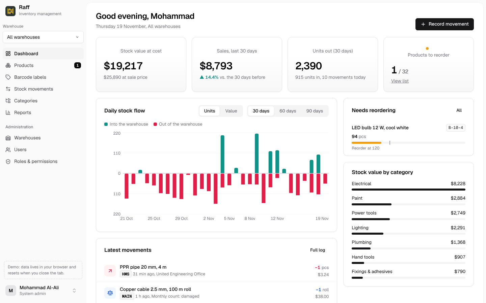

## Features

| Area | What it does |
|---|---|
| **Dashboard** | Stock value (cost and sale), 30-day sales against the previous 30 days, units moved, a reorder alert, a diverging daily in/out chart, products below reorder level, latest movements and stock value per category. |
| **Products** | Search, filter by category or stock status, sortable columns, pagination, and add/edit/archive. Each product has a SKU suggester, shelf location, cost and sale prices with margin, and a reorder level. |
| **Stock movements** | Stock-in, stock-out and stock-count adjustment, plus a full audit log with the balance after each movement. Filter by type, date range or free text, and export to CSV (UTF-8 with BOM so Excel shows Arabic correctly). |
| **Reports** | Any date range: revenue, gross profit and margin, purchases, daily value chart, top-selling products by value or quantity, and stock value per category. |
| **Users & roles** | Create and deactivate users, reset passwords, and a role × permission matrix with 11 permissions that you edit live. |

### Tests

- **API integration tests** (`backend/Raff.Api.Tests`, xUnit): the real API runs in memory against a **real SQL Server started in Docker** by Testcontainers. 26 test cases cover the stock rules (balances, no negative stock, stock counts need a reason, archive instead of delete), permissions per role, protections such as "the last admin can't be deactivated", report numbers (revenue, gross profit, category value, sorting), CSV export and message language.
- **End-to-end tests** (`frontend/e2e`, Playwright): a real browser signs in with different roles, records a stock-in and checks the balance, checks that invalid movements are blocked, checks what each role can see, and switches language and look. They also run at phone size.
- Both suites run in GitHub Actions on every push (see the CI badge above).

```bash
dotnet test Raff.slnx              # needs Docker running
cd frontend && npx playwright install chromium && npm run test:e2e
```

### Engineering details worth noting
- **Permission-based authorization.** Every permission is registered as an ASP.NET Core policy (`[Authorize(Policy = Permissions.ProductsManage)]`) and issued as a `perm` claim in the JWT. The React app hides navigation and actions with the same keys.
- **Stock can only change through movements.** On-hand quantity can't be edited directly. Every change is a `StockMovement` that stores the signed quantity, the resulting balance, the price, the user and the timestamp, so the history is a complete audit trail.
- **Concurrency safety.** `Product.RowVersion` (SQL Server `rowversion`) makes two simultaneous stock-outs on the same item fail cleanly with HTTP 409 instead of corrupting the balance.
- **Business rules on the server.** You can't take out more than is on hand, a stock-count adjustment needs a reason, a product with history is archived instead of deleted, the last active admin can't be deactivated, and the system admin role always keeps every permission.
- **Time zones.** All timestamps are stored in UTC and the API always returns them with `Z`. Reports take the client's UTC offset, so "today" and the daily buckets match the user's local day.
- **Aggregations in SQL.** Dashboard and report numbers are computed with EF Core `GroupBy`/`Sum` queries that run as SQL, not by loading rows into memory.
- **Consistent errors.** A global `IExceptionHandler` turns business errors into RFC 7807 problem responses with user-facing Arabic messages. The frontend shows them in context, either under a field or at the top of the form.
- **Bilingual.** Every string comes from typed dictionaries (`src/i18n/ar.ts`, `en.ts`), so a missing key fails the build. The layout flips direction with `dir` and logical CSS properties, and charts mirror their time axis in Arabic. The API returns its error messages in the language the client sends in `Accept-Language`.
- **Three themes, one set of components.** `src/styles/theme-shadcn.css` and `theme-adminlte.css` restyle the same React components through design tokens. To drop a look, delete its file and its button.
- **Frontend.** TanStack Query handles caching and invalidation, pages are code-split, modals trap focus and close on Esc, keyboard focus is visible, `prefers-reduced-motion` is respected, and the layout works on mobile.
- **Demo mode.** `npm run dev:demo` runs the whole UI against an in-browser copy of the API, with the same endpoints, rules and seed data. You can host it as a static site, such as GitHub Pages, for a live portfolio link.

## Tech stack
- **Backend:** ASP.NET Core 10 Web API, EF Core 10 (SQL Server), JWT Bearer auth, ASP.NET Identity `PasswordHasher`, OpenAPI + Scalar docs
- **Frontend:** React 19, TypeScript, Vite, TanStack Query, React Router, Recharts, Lucide icons, self-hosted fonts (Alexandria and IBM Plex Sans Arabic)
- **Database:** SQL Server (LocalDB, Express or Developer edition)

## Project structure
```
Raff/
├── Raff.slnx
├── backend/Raff.Api/
│   ├── Program.cs              # DI, JWT, permission policies, CORS, OpenAPI
│   ├── Domain/Entities.cs      # Product, Category, StockMovement, User, Role, RolePermission
│   ├── Data/                   # AppDbContext (Fluent config), DbSeeder (roles, users, 4 months of demo activity)
│   ├── Auth/                   # Permissions catalogue, TokenService
│   ├── Dtos/                   # Request/response records with validation
│   ├── Controllers/            # Auth, Products, Categories, Movements, Reports, Users, Roles
│   └── Infrastructure/         # Global exception handler, UTC JSON converter
└── frontend/
    └── src/
        ├── api/                # fetch client, types, demo/ (in-browser API for static demo)
        ├── auth/               # AuthContext + permission keys
        ├── components/         # Layout, ShelfLabel, StockGauge, FlowChart, forms, modal/drawer, toasts
        ├── pages/              # Login, Dashboard, Products, Movements, Categories, Reports, Users, Roles
        └── styles/index.css    # design tokens + all styles
```

## Running it locally

### Requirements
- [.NET 10 SDK](https://dotnet.microsoft.com/download)
- [Node.js 20+](https://nodejs.org)
- SQL Server: Express, Developer or LocalDB (LocalDB ships with Visual Studio)

### 1. API
```bash
cd backend/Raff.Api
dotnet run
```
- The API listens on `http://localhost:5080`. Interactive API docs are at `http://localhost:5080/scalar`.
- On first run the database `RaffInventory` is created and seeded with roles, 4 users, 32 products and about 4 months of movements. To start with an empty catalogue, set `Seed:DemoData` to `false` in `appsettings.json`.
- The connection string in `appsettings.json` uses `Server=localhost` with Windows authentication. For LocalDB, change it to:
  `Server=(localdb)\\MSSQLLocalDB;Database=RaffInventory;Trusted_Connection=True;TrustServerCertificate=True`
- Before deploying, replace `Jwt:Key`, for example with `dotnet user-secrets set "Jwt:Key" "<64+ random chars>"`.

> The schema is created with `EnsureCreated()` to keep setup to one command. To switch to migrations, delete that call in `DbSeeder` and run `dotnet ef migrations add Initial`.

### 2. Web app
```bash
cd frontend
npm install
npm run dev
```
Open `http://localhost:5173`. The Vite dev server proxies `/api` to the API.

### Demo mode (no backend needed)
```bash
cd frontend
npm run dev:demo         # or: npm run build:demo → static files in dist/
```

### Accounts

| Role | Username | Password | Can |
|---|---|---|---|
| مدير النظام (System admin) | `admin` | `Admin@123` | Everything |
| مدير المخزن (Warehouse manager) | `manager` | `Manager@123` | Products, categories, all movements, reports |
| أمين المخزن (Storekeeper) | `keeper` | `Keeper@123` | View products, record stock-in and stock-out |
| مراجع (Auditor) | `viewer` | `Viewer@123` | Read-only and reports |

## API overview

| Method | Route | Permission |
|---|---|---|
| POST | `/api/auth/login` | public |
| GET | `/api/auth/me` | signed in |
| GET/POST/PUT/DELETE | `/api/products`, `/api/products/{id}`, `/api/products/next-sku` | `products.view` / `products.manage` |
| GET/POST/PUT/DELETE | `/api/categories` | `products.view` / `categories.manage` |
| GET | `/api/movements` | `movements.view` |
| POST | `/api/movements` | `movements.in` / `movements.out` / `movements.adjust` (by type) |
| GET | `/api/movements/export` | `reports.view` |
| GET | `/api/dashboard/summary`, `trend`, `low-stock`, `recent` | `dashboard.view` |
| GET | `/api/reports/summary`, `trend`, `top-products`, `category-value` | `reports.view` |
| GET/POST/PUT | `/api/users` | `users.manage` |
| GET/POST/PUT/DELETE | `/api/roles`, `/api/roles/permissions` | `roles.manage` |

## Screenshots

### Three looks, two languages

| | English | العربية |
|---|---|---|
| **shadcn** (default) |  | 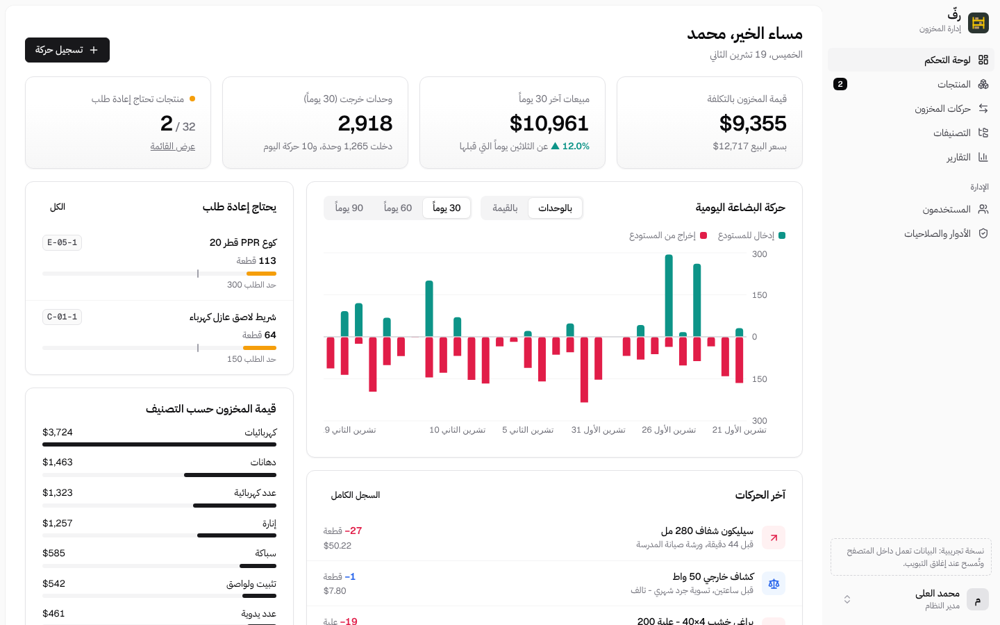 |
| **AdminLTE** | 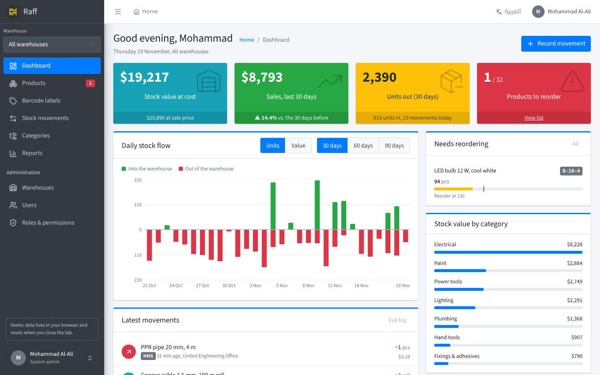 | 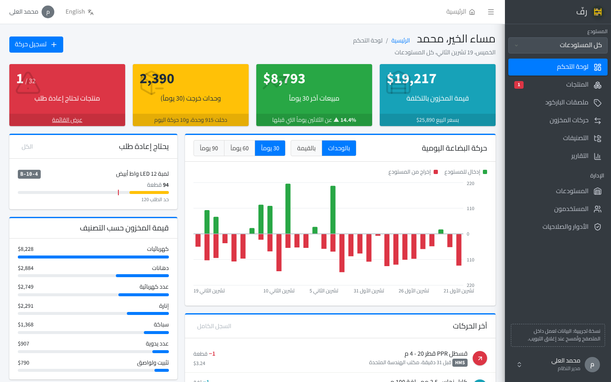 |
| **Raff** | 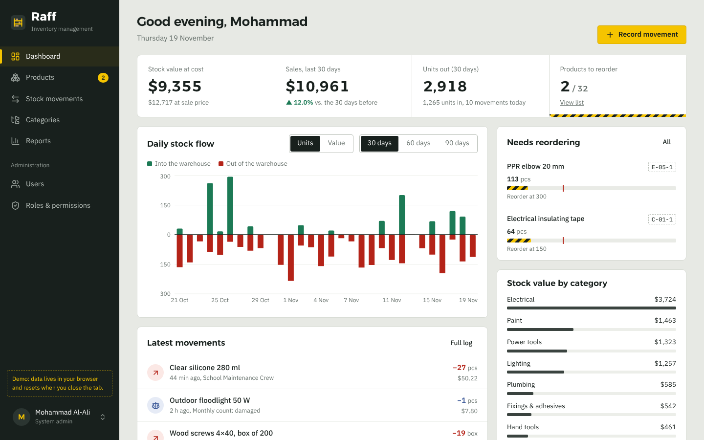 | 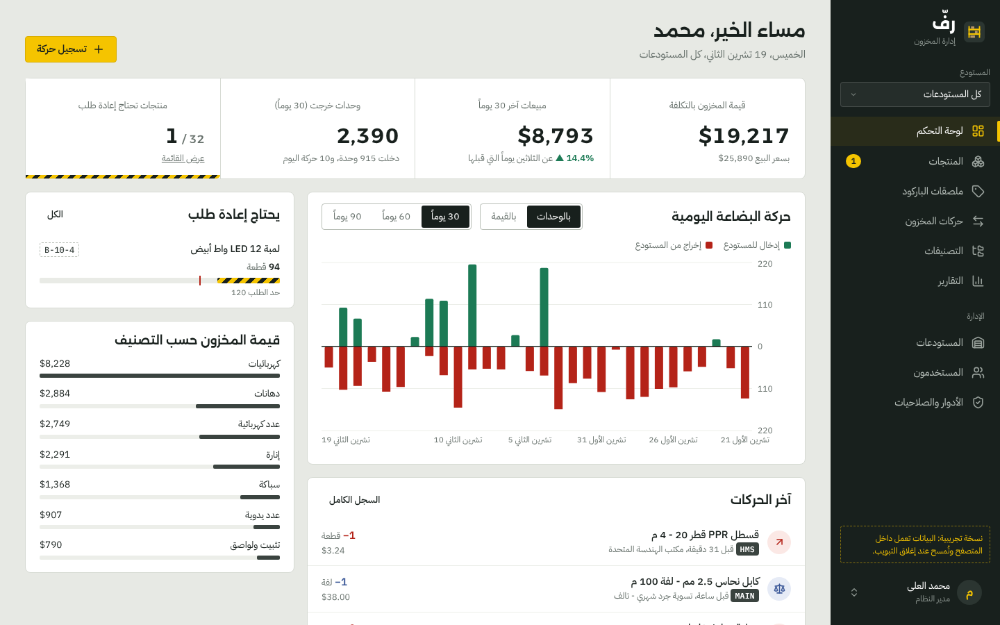 |

### Pages

| | |
|---|---|
| 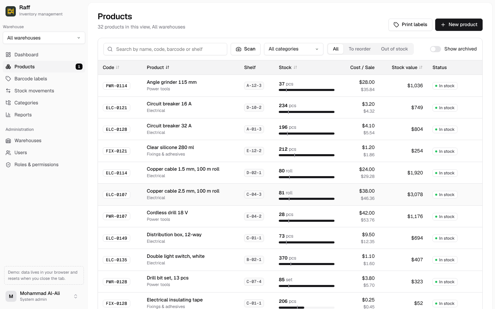 | 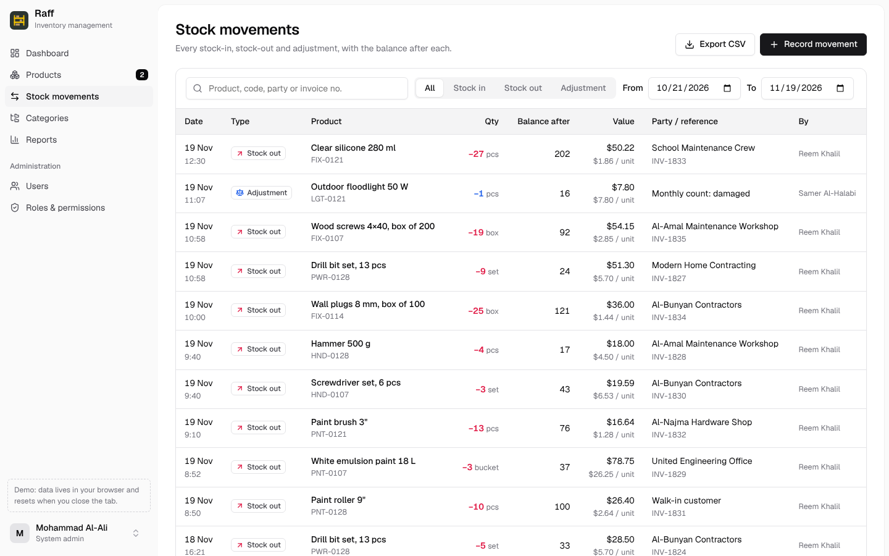 |
| 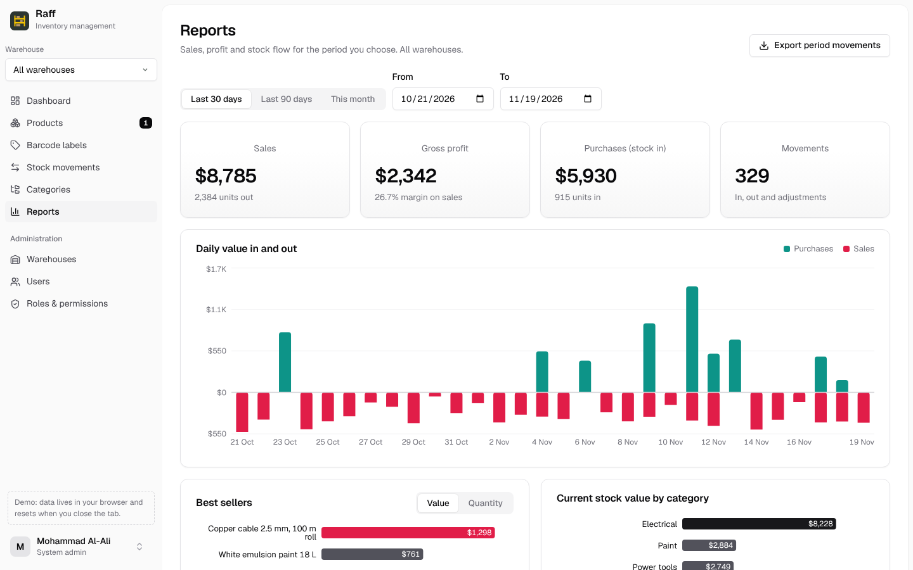 | 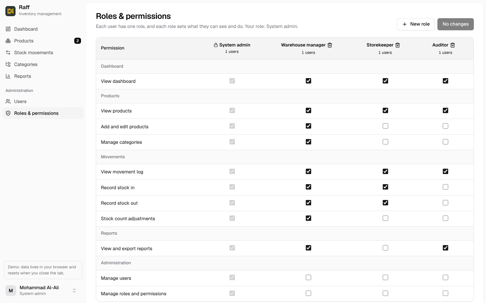 |
| 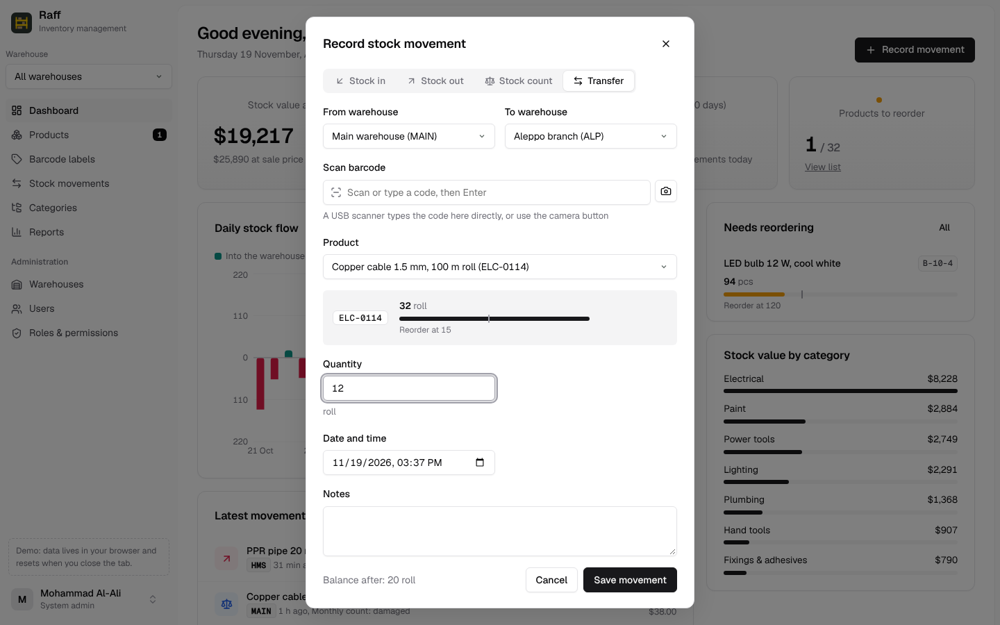 | |

---

### بالعربي

**رفّ** نظام لإدارة المخزن أو المتجر، بواجهة عربية وإنكليزية وتلات أشكال بيختار بيناتهن المستخدم. فيه لوحة تحكم بالأرقام والرسوم، وإدارة المنتجات والتصنيفات، وتسجيل حركات الإدخال والإخراج وتسوية الجرد مع سجل كامل، وتقارير للمبيعات والأرباح مع تصدير CSV، وصلاحيات مستخدمين يمكن تعديلها من مصفوفة الأدوار.
للتشغيل: شغّل الـ API بأمر `dotnet run`، ثم الواجهة بأمر `npm run dev`. ولتجربة الواجهة بدون خادم: `npm run dev:demo`.
